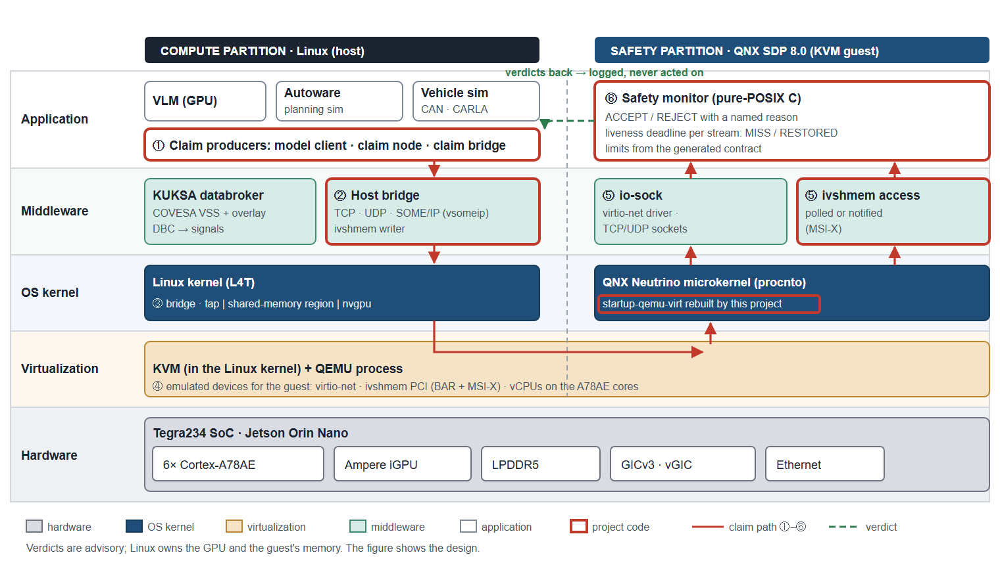

# qnx-linux-dual-vm-proxy

A study of DRIVE OS-style dual-VM partitioning on a Jetson Orin Nano: Linux (L4T) keeps the metal and the GPU, and
QNX SDP 8.0 runs beside it as a KVM guest with a safety monitor. Nothing in it is certified, and no measured result is
published (see [Limits](#limits-and-results-policy)).

<!-- The Phase badge is generated from the Status table by scripts/ci/render_badges.py and checked by
     .github/workflows/claims-gate.yml. Change the table and re-run `python scripts/ci/render_badges.py --write`.
     This file is overwrite-only: replace sentences, never strike them through. -->

---

## What runs on it

On the Jetson Orin Nano, with the QNX guest booted under KVM:

- **Model answers.** A vision-language model on the GPU answers; each answer is judged in the guest, with a liveness
  deadline per stream.
- **Driving commands.** Autoware's planning simulator runs in containers; each control command after Autoware's own
  gate is judged in the guest.
- **Vehicle signals.** Simulated CAN data or a recorded CARLA drive flows through a KUKSA databroker as COVESA VSS
  signals; the latest signals are judged in the guest.
- **Transports.** Claims travel over TCP, UDP, SOME/IP and shared memory.
- **Software updates.** An over-the-air drill moves a databroker app through versions and refusals.

The same image also boots on AWS bare-metal Arm instances as a test bed. These are functional outcomes of the
project's own code.

---

## What was built

| Part | Where |
|---|---|
| The partition: QEMU with KVM on L4T hosting the QNX guest, with a `startup-qemu-virt` rebuilt from board source | [`orin-native/`](orin-native/), [`scripts/orin/`](scripts/orin/) |
| The safety monitor: pure POSIX C, ACCEPT or REJECT with a named reason for each claim in a fixed frame, plus a liveness deadline | [`ipc-test/qnx-safety-monitor/`](ipc-test/qnx-safety-monitor/) |
| IPC across the boundary: TCP and UDP over virtio-net; shared memory over `ivshmem`, polled or notified (virtio console, doorbell, MSI-X through the GIC ITS); SOME/IP with vsomeip; a Cyclone DDS variant | [`ipc-test/`](ipc-test/), [`orin-native/someip/`](orin-native/someip/) |
| The SDV slice: a VSS contract generated from pinned inputs, a claim bridge and claim node, a first app, digest-pinned containers with an OTA updater, and a minimal AWS IoT twin | [`sdv/`](sdv/) |
| An edge-AI service on the Linux side: a resident vision-language model on the GPU | [`orin-native/edge-llm/`](orin-native/edge-llm/) |
| A measurement method with pre-registered predictions per harness | [measurement-design.md](docs/measurement-design.md) |
| Bare-metal AWS tooling for test sessions | [`scripts/aws/`](scripts/aws/) |
| A CI gate over the repo's own prose: no figure, no unsupported claim, no run record in the tree | [`scripts/ci/`](scripts/ci/) |

Earlier architectures, including a native QNX Hypervisor port, are recorded in
[the plan](docs/orin-native-port-plan.md) and [architecture.md](docs/architecture.md).

---

## Limits and results policy

- Not certified and not a safety case: QNX SDP 8.0 is not QNX OS for Safety.
- No isolation claim: under KVM, Linux owns the guest's memory. No real-time guarantee and no GPU for QNX.
- The guest's startup is rebuilt by this project, so this is not a QNX-supported configuration.
- Clause 4.6(i) of the QNX Development License Agreement bars publishing evaluation results without BlackBerry's
  approval, so no measured result or run record is published; they are held locally.

The full comparison with DRIVE OS is in [drive-os-comparison.md](docs/drive-os-comparison.md).

---

## Status

✅ closed · 🟡 in progress · ⬜ not started

| Phase | Status | Where to read |
|---|---|---|
| **0** — Bootstrap, BSP research, twin re-scope | ✅ closed | [bsp-selection.md](docs/bsp-selection.md) |
| **1** — Cloud twin bring-up: QHV `qvm` + QNX guest under TCG | ✅ closed as A1 history; results held locally | [ADR-002](docs/phase2-topology-decision.md) |
| **2** — Cloud twin IPC + latency | ✅ closed as A1 history; results held locally | [digital-twin-design.md](docs/digital-twin-design.md) |
| **3** — Hardware twin port (Orin Nano) | ✅ closed as A2 history; results held locally | [orin-port.md](docs/orin-port.md) |
| **3b** — Native QNX on the Orin, then A6 | 🟡 in progress; results held locally | [the plan](docs/orin-native-port-plan.md) |
| **4** — Twin diff + DRIVE OS comparison | ✅ closed; results held locally | [drive-os-comparison.md](docs/drive-os-comparison.md) |
| **5** — FuSa & Cybersecurity overlay | ⬜ not started as a dedicated phase | [fusa/](docs/fusa/), [cyber/](docs/cyber/) |
| **6** — Polish, public README, demo | ⬜ not started | — |
| **7** _(stretch)_ — Multi-SoC / domain convergence | ⬜ feasibility frozen, not built | [future-multi-soc.md](docs/future-multi-soc.md) |

---

## Setup

Walkthrough: [scripts/README.md](scripts/README.md). You must obtain your own QNX licence and install QNX SDP 8.0;
this repo ships no QNX component. Board work needs a 3.3 V USB-TTL adapter on the Orin's J14 header and someone at
the plug: a hung run after `kexec` needs a physical power cycle.

## Repository layout

| Path | What |
|---|---|
| [`docs/`](docs/) | design, decisions and the dated record ([findings.md](docs/findings.md)) |
| [`orin-native/`](orin-native/) | native-port source, the A6 harnesses, the edge-AI service, SOME/IP tooling |
| [`sdv/`](sdv/) | the software-defined-vehicle slice |
| [`ipc-test/`](ipc-test/) | the safety monitor, servers, clients and the shared frame (C99) |
| [`scripts/`](scripts/) | bring-up, AWS bare-metal tooling, the CI gate |
| [`tests/`](tests/) | unit tests on synthetic data |

## Author

Hao Chen — Research Engineer at DENSO Automotive Deutschland GmbH. Personal project, built on my own time and hardware.

## License

[MIT](LICENSE) for the source, scripts and documentation here; [NOTICE](NOTICE) gives its scope. QNX SDP and Linux
distributions stay under their own licences and are not redistributed.
